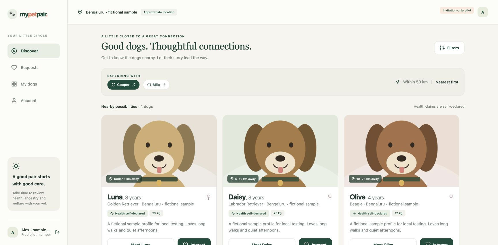

# MyPetPair

MyPetPair is an invite-only dog breeding introduction pilot. Owners manage multiple dogs, discover nearby profiles, send male-to-female interest requests and independently control contact sharing after acceptance. Health claims are self-declared; a connection does not certify breeding suitability.

The backend uses Java 17 and Spring Boot. One Expo React Native and React Native Web application targets web, Android and iOS. The [architecture decision](docs/ARCHITECTURE.md) compares the frontend options and records the selected approach, GCP services and cost drivers. No payments are implemented.



## Product and specifications

The [PRD](docs/PRD.md) separates confirmed requirements, delegated defaults and public-launch decisions. The [Spec Kit feature](specs/001-owner-matching/spec.md), [implementation plan](specs/001-owner-matching/plan.md), [tasks](specs/001-owner-matching/tasks.md) and [independent review](docs/SPEC_REVIEW.md) define implementation and acceptance criteria.

- [REST API contract](specs/001-owner-matching/contracts/api.md)
- [Database model and lifecycle](specs/001-owner-matching/data-model.md)
- [Operations and environment configuration](docs/OPERATIONS.md)
- [Privacy safety and launch decisions](docs/PRIVACY_SAFETY.md)
- [Verification evidence](docs/VERIFICATION.md)
- [Repository and deployment status](docs/RELEASE.md)

## Local backend

Install Java 17, Maven, Node.js 22.14 or newer and npm. Docker is optional for local PostgreSQL; H2 requires no database installation.

```sh
cd backend
mvn -s maven-settings.xml test
mvn -s maven-settings.xml spring-boot:run
```

The API listens on `http://localhost:8080`; `GET /api/health` returns its status. The default development database is file-backed H2 at `backend/data/mypetpair` when started from `backend`. Flyway applies schema migrations at startup. Use PostgreSQL for deployed environments.

The project Maven settings file resolves dependencies from public Maven Central and keeps builds independent of machine-specific private mirrors. It contains no credentials.

For fictional sample data, stop the backend and restart it from the repository root as follows. Seed mode must never be enabled on a deployment containing real users.

```sh
cd backend
APP_SEED=true mvn -s maven-settings.xml spring-boot:run
```

The seeded accounts are `male@example.invalid`, `female@example.invalid` and `moderator@example.invalid`. Their deliberately public, local-only password is `Fictional-local-only-42!`. These are test fixtures, not deployable credentials. The seeded moderator is enabled only in local seed mode. PostgreSQL startup rejects seed mode.

Use the male owner to discover a female dog and send interest, then switch to the female owner and accept it. Check that acceptance alone reveals no counterparty email or phone. Grant one channel, switch owner to inspect it, then revoke it and verify that subsequent reads hide it. Use the moderator account to review pending dogs and reports. A third ordinary account must remain unable to edit others' profiles or read their private contacts.

## Web and native clients

In a second terminal, install the locked client dependencies and start web development:

```sh
cd frontend
npm ci
EXPO_PUBLIC_API_URL=http://localhost:8080 npm run web
```

The development web client uses the configured backend origin. The deployed web export is served by Spring from the same origin; omit `EXPO_PUBLIC_API_URL` when creating that export.

For a native development client, set `EXPO_PUBLIC_API_URL` to the backend's reachable HTTPS origin and run `npm start`. A physical phone cannot use the development computer's `localhost`; a local-only device test needs the computer's reachable LAN address and appropriate network permissions. `npm run android` and `npm run ios` open supported development targets when their tools are installed.

```sh
cd frontend
npm run typecheck
npm run lint
npm run export:all
```

The all-platform export creates web assets plus Android/iOS JavaScript bundles. Use `npm run export:web` for the Spring-served web artifact. The deployment build includes that artifact with the backend; see the root Dockerfile and [operations](docs/OPERATIONS.md).

Native signing and cloud builds use the profiles in `frontend/eas.json`. Configure a user-owned Expo/EAS project, application identifiers and Apple/Google credentials before producing signed installable builds. Do not commit signing material. No store release is implied by a successful JavaScript export.

## Environment configuration

Set backend environment variables in the server process. Do not commit local configuration, passwords, invitation codes, session tokens or native signing credentials. Public client environment variables are embedded in the app and must contain no secrets.

The root `.env.example` is a local configuration reference; Spring does not automatically load a copied `.env` file. Its JDBC URL overrides the default H2 path to `./.local/mypetpair`, relative to the backend process's working directory. Quote JDBC URLs containing semicolons when entering them in a shell.

| Variable | Local default | Purpose |
|---|---|---|
| `PORT` | `8080` | Backend HTTP port |
| `DB_URL` | File-backed H2 | JDBC URL; production requires PostgreSQL |
| `DB_USERNAME` | `sa` | Database user |
| `DB_PASSWORD` | Empty for local H2 | Production password from Secret Manager |
| `APP_INVITATION_REQUIRED` | `false` locally | Require invitation during registration; enable in production |
| `APP_INVITATION_CODE` | None | Server-only invitation secret when registration is gated |
| `APP_ADMIN_OWNER_IDS` | None | Comma-separated independently verified owner UUIDs |
| `APP_SEED` | `false` | Fictional local H2 seed data only |
| `CORS_ALLOWED_ORIGINS` | `http://localhost:8081,http://localhost:19006` | Development web origin allowlist |
| `AUTH_RATE_LIMIT` | `20` | Authentication attempts per source IP per 15-minute window |
| `WRITE_RATE_LIMIT` | `120` | Authenticated writes per owner per minute |
| `EXPO_PUBLIC_API_URL` | Same origin on web | Public API origin embedded in the client; set a reachable HTTPS origin for native |

Administrator privileges cannot be acquired by registering an allowlisted email. An operator verifies control of an existing account, obtains its owner ID and configures that immutable ID on the server. See [operations](docs/OPERATIONS.md).

A PostgreSQL backend requires the invitation gate and a nonempty invitation secret and rejects `APP_SEED=true`. No separate Spring `prod` profile is required.

For optional local PostgreSQL, set a private `LOCAL_DB_PASSWORD` in your shell, then run `docker compose up -d postgres` from the repository root. The container binds only to `127.0.0.1:5432` and persists data in the `postgres-data` volume. Start the backend with `DB_URL=jdbc:postgresql://localhost:5432/mypetpair`, `DB_USERNAME=mypetpair`, `DB_PASSWORD` equal to that local password, `APP_SEED=false`, `APP_INVITATION_REQUIRED=true` and a private nonempty `APP_INVITATION_CODE`. The SQL container is local development infrastructure; it is not the GCP deployment.

## Release boundaries

An exported Android or iOS JavaScript bundle is not a signed installable app or an app-store release. Native device testing, signing, publisher accounts and store review are separate steps. Consult the verification report for checks actually executed.

Open public registration requires a launch jurisdiction, operator privacy and terms notices, veterinary policy, staffed moderation/support and email verification/recovery. The invite-only pilot does not verify email ownership. Consent can stop future contact access; it cannot retract details already copied. These limitations are covered in the [privacy and safety guide](docs/PRIVACY_SAFETY.md).
